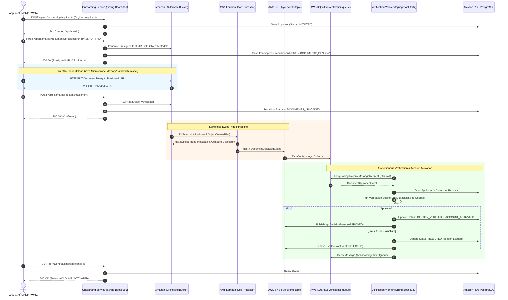

# Hybrid Serverless-Microservices KYC & Digital Onboarding Platform

[](https://openjdk.org/)
[](https://spring.io/projects/spring-boot)
[](https://aws.amazon.com/s3/)
[](https://aws.amazon.com/lambda/)
[](https://aws.amazon.com/sqs/)
[](https://www.postgresql.org/)
[](https://www.docker.com/)
[](https://www.terraform.io/)
[](https://kubernetes.io/)

An enterprise-grade, asynchronous customer identity verification and digital banking onboarding platform. Inspired by **Stripe Identity**, **Onfido**, and tier-1 digital banking engines, this platform bridges **Spring Boot microservices** with **AWS Serverless (Lambda, S3, SNS, SQS)** to achieve zero-bandwidth file ingestion, high-throughput asynchronous document verification, and a resilient, auditable KYC state machine.

---

## 🏛️ High-Level System Architecture

```
                    [ Customer / Applicant ]
                               │
               1. Request S3 Presigned URL
                               ▼
                    [ Onboarding Service ] 
                    (Spring Boot / Port 8081)
                               │
            2. Direct Upload   ▼   3. Object Created Event
               ┌──────────► [ Amazon S3 ] ──────────┐
               │         (Private Bucket)           │
        [ Applicant ]                               ▼
                                             [ AWS Lambda ]
                                        (Image Validation & Check)
                                                    │
                                                    ▼
                                             [ AWS SNS / SQS ]
                                                    │
                                                    ▼
                                        [ KYC Verification Worker ]
                                         (Spring Boot Background)
                                                    │
                                                    ▼
                                            [ Amazon RDS Postgres ]
```

---

## 🔄 Sequence Diagram & Workflow



---

## 🎯 Core Architectural Problems Solved

### 1. Eliminating Microservice Bandwidth & Memory Bottlenecks (S3 Presigned URLs)
* **The Problem**: In conventional web applications, users upload heavy PDF bank statements or high-resolution ID photos (10–25 MB each) directly to backend Spring Boot endpoints via `MultipartFile`. Ingesting, buffering, and parsing hundreds of concurrent uploads saturates heap memory, triggers aggressive Garbage Collection pauses, and exhausts thread pools, causing catastrophic `OutOfMemoryError` failures.
* **The Solution**: The client requests a cryptographically signed **Amazon S3 Presigned URL** with short expiration (15 minutes). The client then performs an **HTTP PUT directly to Amazon S3**. The Spring Boot microservice never buffers the document bytes, allowing tiny container instances (250m CPU, 512Mi RAM) to handle tens of thousands of onboarding customers concurrently.

### 2. Serverless Document Ingestion Pipeline (AWS Lambda & S3 Event Notifications)
* **The Problem**: Polling S3 for newly uploaded objects is inefficient and expensive. Conversely, having clients notify the backend when an upload finishes creates race conditions where the client might report success before S3 finishes replicating the object.
* **The Solution**: An **S3 Event Notification** automatically invokes an **AWS Lambda function** (`DocumentProcessorLambda`) immediately upon `s3:ObjectCreated:*`. The Lambda extracts object metadata (`applicant-id`, `document-type`), executes cryptographic SHA-256 integrity hashing, and publishes a structured `DocumentUploadedEvent` to AWS SNS.

### 3. Fan-Out Decoupling Architecture (AWS SNS to AWS SQS)
* **The Problem**: A single document upload event must trigger multiple independent downstream processes: identity verification, compliance audit logging, fraud screening, and customer SMS/Email alerts. Hard-coupling these into one service violates Single Responsibility and risks cascading failures.
* **The Solution**: **AWS SNS Topic (`kyc-events-topic`)** acts as the event fan-out publisher. Multiple independent **AWS SQS Queues** subscribe to the topic:
  - `kyc-verification-queue` (consumed by the `VerificationWorker`)
  - `kyc-audit-compliance-queue` (consumed by compliance loggers)
  - `kyc-notifications-queue` (consumed by customer notification workers)
  Adding a new downstream consumer requires zero changes to the Lambda or producer code.

### 4. Resilient Asynchronous Queue Workers & Dead-Letter Queues (DLQ)
* **The Problem**: External banking checks, OCR microservices, or database locks can intermittently fail. If consumer worker threads crash or drop messages, customers get stuck indefinitely in an incomplete onboarding state.
* **The Solution**:
  - The `VerificationWorker` leverages **SQS Long Polling (`WaitTimeSeconds: 20`)** to eliminate empty API responses and reduce AWS API costs by up to 90%.
  - Configured with a **Visibility Timeout (30s)**: If a worker crashes midway through verification, SQS automatically makes the message visible again for another worker instance to pick up.
  - **Dead-Letter Queue (DLQ)** with redrive policy (`maxReceiveCount: 3`): Poison-pill messages that fail processing 3 times are sequestered into `kyc-verification-dlq` for manual inspection and alerting, preventing queue poisoning.

### 5. Strict State Machine & Optimistic Locking
* **State Machine Flow**:
  $$\text{INITIATED} \longrightarrow \text{DOCUMENTS\_PENDING} \longrightarrow \text{DOCUMENTS\_UPLOADED} \longrightarrow \text{IDENTITY\_VERIFIED} \longrightarrow \text{ACCOUNT\_ACTIVATED}$$
  *(or $\text{REJECTED}$ with reason)*
* **Concurrency Protection**: The `Applicant` entity uses JPA `@Version` optimistic locking to prevent concurrent state corruption when multiple background processes or API requests arrive simultaneously.

---

## 📁 Repository Structure

```
hybrid-serverless-kyc-platform/
├── pom.xml                               # Root multi-module Maven POM
├── docker-compose.yml                    # LocalStack (S3, SNS, SQS, Lambda) & PostgreSQL 16
├── build.ps1                             # Automated build script
├── setup-git.ps1                         # Git repository initialization script
├── docker/
│   └── init-aws.sh                       # LocalStack automated resource provisioner
├── kyc-contracts/                        # Shared lightweight event contracts and DTOs
│   └── src/main/java/com/bank/kyc/
│       ├── dto/ApplicantStatus.java      # KYC lifecycle state enum
│       ├── dto/DocumentType.java         # PASSPORT, DRIVING_LICENSE, etc.
│       ├── event/DocumentUploadedEvent.java
│       └── event/KycDecisionEvent.java
├── onboarding-service/                   # Customer-facing Spring Boot Microservice (Port 8081)
│   ├── Dockerfile
│   └── src/main/java/com/bank/kyc/onboarding/
│       ├── controller/OnboardingController.java
│       ├── service/ApplicantService.java
│       ├── service/S3PresignedUrlService.java
│       ├── entity/Applicant.java
│       └── entity/DocumentRecord.java
├── lambda-processor/                     # Serverless AWS Lambda Event Handler (Java 17)
│   └── src/main/java/com/bank/kyc/lambda/
│       └── DocumentProcessorLambda.java
├── verification-worker/                  # Asynchronous SQS Worker Microservice (Port 8082)
│   ├── Dockerfile
│   └── src/main/java/com/bank/kyc/worker/
│       ├── listener/SqsMessageListener.java
│       ├── service/KycVerificationService.java
│       ├── controller/WorkerHealthController.java
│       └── entity/Applicant.java
├── terraform/                            # Production AWS Infrastructure as Code
│   ├── main.tf                           # S3, Lambda, SNS, SQS, RDS, IAM definitions
│   ├── variables.tf
│   └── outputs.tf
├── k8s/                                  # Production Kubernetes Manifests
│   ├── onboarding-service.yaml
│   ├── verification-worker.yaml
│   └── configmap.yaml
└── scripts/
    ├── demo-test.ps1                     # PowerShell End-to-End Simulation Suite
    └── demo-test.sh                      # Bash / cURL End-to-End Simulation Suite
```

---

## 💼 Recruiter & Hiring Manager Cheat Sheet

### Resume Keyword Mapping
| Resume Keyword | Where & How It Is Used in This Project |
| :--- | :--- |
| **AWS S3** | Private document bucket with versioning, SSE-AES256, CORS, and presigned PUT URL generation. |
| **AWS Lambda** | Serverless Java 17 handler triggered by S3 `ObjectCreated` to extract metadata and publish events. |
| **AWS SNS** | Topic fan-out architecture decoupling ingestion from downstream verification and audit services. |
| **AWS SQS** | Decoupled message queue with long-polling (20s), visibility timeout, and Dead-Letter Queue (DLQ). |
| **Spring Boot 3** | REST API (`onboarding-service`) and background consumer (`verification-worker`) on Java 17. |
| **PostgreSQL 16** | Relational state store with indexes, unique constraints, and JPA `@Version` optimistic locking. |
| **Terraform** | Declarative IaC provisioning S3, IAM least-privilege roles, SNS, SQS, Lambda, and RDS. |
| **Docker / LocalStack** | Full offline AWS cloud emulation for frictionless local testing and CI/CD pipelines. |

### Top Senior Interview Questions & Answers

#### Q1: "Why not upload files through your Spring Boot backend service?"
> *"Uploading files through Spring Boot creates a severe bottleneck: backend servers must buffer high-resolution images and PDFs in memory or temp disks, multiplying network bandwidth usage and making JVM heaps vulnerable to OutOfMemoryErrors under spike loads. By issuing an S3 Presigned PUT URL, the client streams the file directly to Amazon S3. The backend remains lightweight, stateless, and capable of scaling horizontally without worrying about file transfer bandwidth."*

#### Q2: "How does the platform handle poison pill messages or worker failures in SQS?"
> *"We configure an SQS visibility timeout of 30 seconds and long polling of 20 seconds. If a worker crashes or fails while processing a message, it never calls `deleteMessage()`. Once the visibility timeout expires, SQS makes the message available for another worker instance. If the message fails consecutively 3 times (e.g. malformed JSON or corrupted data), the SQS redrive policy automatically routes it to `kyc-verification-dlq`. This isolates toxic messages, triggers CloudWatch alerts, and prevents queue blockage."*

#### Q3: "Why use Lambda between S3 and SNS rather than sending S3 notifications directly to SNS?"
> *"While S3 can notify SNS directly, the raw S3 notification payload contains only the bucket and key. In an enterprise KYC architecture, we need to extract custom object user-metadata (`applicant-id`, `document-type`), compute cryptographic SHA-256 checksums, and validate headers before events hit the messaging backbone. AWS Lambda serves as an ultralight, autoscaling serverless validation filter that enriches and transforms raw cloud events into strongly typed domain events (`DocumentUploadedEvent`)."*

#### Q4: "How do you guarantee idempotency if SQS delivers the same event more than once?"
> *"AWS SQS standard queues provide 'at-least-once' delivery, which means duplicates can occur. In our platform, every event carries an immutable `eventId` and `s3Key`. In PostgreSQL, `document_records` has a unique constraint on `s3_key`, and the `Applicant` entity uses optimistic locking (`@Version`). If a duplicate message arrives, the worker checks if the document record has already been marked `verified = true`, safely acknowledging and discarding the duplicate without re-executing state machine transitions."*

---

## 🚀 Quickstart & Local Setup

### Prerequisites
- **Docker & Docker Compose** (version 20.10+)
- **Java 17 or 21** (Optional if running entirely via Docker Compose)

### 1. Launch Platform with Docker Compose
Clone the repository and start all services (Postgres, LocalStack, Onboarding Service, Verification Worker):

```bash
docker compose up --build -d
```

Check running containers:
```bash
docker compose ps
```

LocalStack automatically creates the S3 bucket, SNS topic, SQS queues, and DLQ via `docker/init-aws.sh`.

---

### 2. Run the Automated End-to-End Test Suite

Run the complete simulation test suite (registers user, requests presigned URL, uploads document, triggers serverless pipeline, and verifies account activation):

#### On Windows (PowerShell):
```powershell
.\scripts\demo-test.ps1
```

#### On Linux / macOS (Bash):
```bash
chmod +x ./scripts/demo-test.sh
./scripts/demo-test.sh
```

---

## 📡 REST API Reference

| Method | Endpoint | Description |
| :--- | :--- | :--- |
| `POST` | `/api/v1/onboarding/applicants` | Register a new customer (`status: INITIATED`) |
| `POST` | `/api/v1/onboarding/applicants/{id}/documents/presigned-url` | Generate S3 Presigned URL (`status: DOCUMENTS_PENDING`) |
| `POST` | `/api/v1/onboarding/applicants/{id}/documents/confirm` | Confirm direct S3 upload completion (`status: DOCUMENTS_UPLOADED`) |
| `GET` | `/api/v1/onboarding/applicants/{id}` | Check customer KYC onboarding status (`status: ACCOUNT_ACTIVATED`) |
| `GET` | `/api/v1/onboarding/applicants/{id}/documents` | Retrieve customer document verification records & notes |
| `GET` | `/api/v1/worker/status` | Verification Worker health and SQS processed message metrics |

---

## 👨‍💻 Author & Contact

**Debayan Mondal**  
*Senior Java / Spring Boot & Cloud Architect*  
- GitHub: [https://github.com/Debayanmondal](https://github.com/Debayanmondal)
- Project Repository: [https://github.com/Debayanmondal/hybrid-serverless-kyc-platform](https://github.com/Debayanmondal/hybrid-serverless-kyc-platform)
